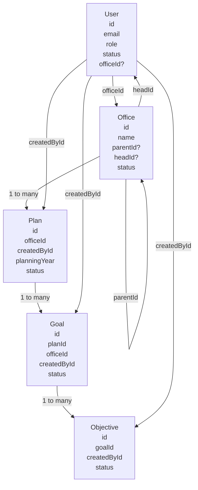

# RBAP API Flow Map

## Why The Playwright Audit Uses Direct Fixtures First

- `POST /api/v1/auth/dev-login` only works for users that already exist in the database.
- The backend currently has admin endpoints to manage users and offices, but it does not have a public endpoint to create a brand-new user.
- Because of that, the audit first inserts traceable users and offices directly with Prisma, then logs those same users in through the real auth endpoint.

That is the important senior-level distinction: the direct inserts only solve test setup. The actual endpoint behavior is still exercised through HTTP after setup.

## Table Relationship Map

## What Each Connection Means

1. `User.officeId -> Office.id`
   This is the office membership link. It is what the auth layer uses to decide a user's visibility scope.

2. `Office.headId -> User.id`
   This marks the official head of the office. The office can still have many member users, but only one `headId`.

3. `Office.parentId -> Office.id`
   This is the self-referencing tree that models the organization structure.

4. `Plan.officeId -> Office.id`
   A plan belongs to one office. The database also enforces one plan per office per planning year.

5. `Plan.createdById -> User.id`
   This stores which authenticated user created the plan.

6. `Goal.planId -> Plan.id`
   Goals are children of one plan.

7. `Goal.officeId -> Office.id`
   Goals also keep the office id directly, which makes office-scoped filtering cheaper.

8. `Goal.createdById -> User.id`
   This stores who created the goal.

9. `Objective.goalId -> Goal.id`
   Objectives are children of one goal.

10. `Objective.createdById -> User.id`
    This stores who created the objective.

## Request Flow From Login To Approval

1. A user authenticates through `POST /api/v1/auth/dev-login`.
2. The JWT token is later resolved by the auth guard, which rebuilds `req.user` with role and office context.
3. The office hierarchy rules in `OfficesService.getAccessibleOfficeIds()` decide which offices the user can see.
4. An office-scoped user such as an `OFFICE_HEAD` creates a plan through `POST /api/v1/plans`.
5. The same office user creates goals under that plan with `POST /api/v1/plans/:planId/goals`.
6. The same office user creates objectives under a goal with `POST /api/v1/plans/:planId/goals/:goalId/objectives`.
7. While the parent plan is still `DRAFT`, that same office can update or delete its own plan, goals, and objectives.
8. Once the office submits the plan with `PATCH /api/v1/plans/:id/submit`, the plan moves to `SUBMITTED`; the owning office may still update the plan, goals, and objectives until approval.
9. The assigned supervisor receives a notification and sees only their review queue in `GET /api/v1/plans/pending-approvals`.
10. That assigned supervisor reviews and approves the submitted plan with `PATCH /api/v1/plans/:id/approve`, moving it to `APPROVED`.

## Access Rules That Control Visibility

1. `ADMIN` and `PRESIDENTS` can see all active offices.
2. `VICE_PRESIDENTS` can see their whole office subtree.
3. `DIRECTORS` can see their own office plus direct child offices.
4. `OFFICE_HEAD` can only see their own office.
5. Non-admin users can only edit draft or submitted records that belong to their own office.
6. A submitted plan can only be approved by the supervisor assigned to its submitter.

## Lifecycle Rules That Matter During Testing

1. `Plan` status moves from `DRAFT` to `SUBMITTED` to `APPROVED`.
2. A non-admin owner can edit a submitted plan, but an approved plan remains locked.
3. Goals and objectives inherit the same draft-or-submitted edit rule because their services check the parent plan status.
4. A non-admin owner can delete a plan only while it is `DRAFT`; deleting a plan cascades to goals.
5. Deleting a goal cascades to objectives because the Prisma relations use `onDelete: Cascade`.

## How To Inspect Audit Rows In The Database

1. Look for users where `email` starts with `api.audit.`.
2. Look for offices where `name` starts with `API AUDIT`.
3. Use the ids written to `docs/playwright-api-audit.latest.md` to inspect plans, goals, and objectives.
4. Read `docs/playwright-api-audit.latest.json` if you want the same data in machine-readable form.
